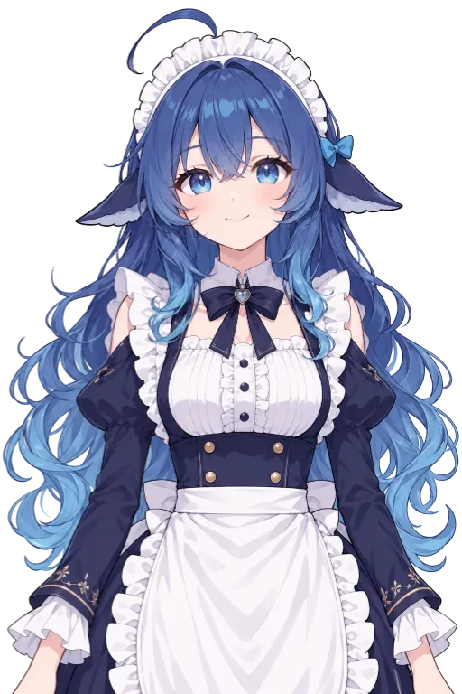
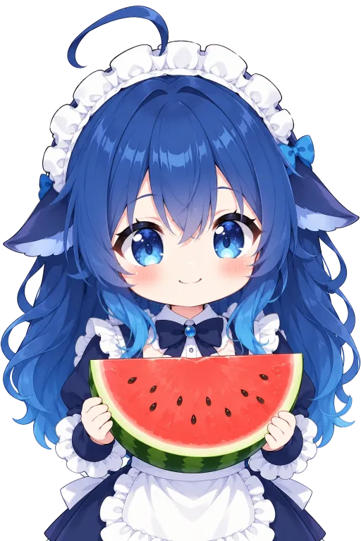

# 安静的鲸鱼娘 · Quiet Whale Girl

English · [简体中文](README.zh-CN.md)

A quiet 2.5D whale-girl desktop pet for **DeepSeek Harness (DSH)**. She sits in the corner of the DSH Web GUI, follows your cursor with her eyes, blinks and smiles now and then, and reacts when you tap her. Switch between two forms with one click: Kujira (realistic) and Kujira Q (chibi).

She is *quiet* on purpose: no voice, no network calls, no prompt injection, no tool calls. Just a companionsprite on your DSH page, rendered locally through [LivLiv Player](https://github.com/livliv-dev/player).

> This is an unofficial community character and plugin. It is not affiliated with, endorsed by, or connected to DeepSeek or LivLiv.

<table align="center">
  <tr>
    <td align="center"><br /><b>Kujira · realistic (p01)</b></td>
    <td align="center"><br /><b>Kujira Q · chibi (p02)</b></td>
  </tr>
</table>

---

## Features

- **A pet that lives in DSH** — rendered as a floating overlay on top of the DSH Web GUI (`shell.overlay`), draggable anywhere, remembers position and settings in `localStorage`.
- **Two whale forms** — Kujira (`p01`, realistic) and Kujira Q (`p02`, chibi), switchable from a small button on the pet.
- **Gentle life** — eyes follow the cursor; occasional blink, soft smile or shy look at long, irregular intervals. Tap the character for a nod / tilt / shy reaction.
- **Local-first** — the renderer and character files are bundled in the plugin and served by the host over a same-origin route. No CDN, no external API, no telemetry.
- **Quiet by design** — no speech, no ASR/TTS, no session or tool event hooks, no changes to your prompts or agent behaviour.

## Requirements

| Item | Version |
|---|---|
| DeepSeek Harness | web profile, with plugin support (`0.1.x` or `0.2.x`) |
| Node.js | `>= 22.12.0` (host side; DSH provides this) |
| Browser | WebGL2 + ES2023 (Chrome / Edge 97+, Firefox 104+, Safari 15.4+) |

## Install

From npm:

```sh
dsh plugin --profile web add dsh-quiet-whale-girl
dsh web
```

From GitHub source:

```sh
dsh plugin --profile web add "github:marchinlab/dsh-quiet-whale-girl"
```

Or link a local checkout for development:

```sh
git clone https://github.com/marchinlab/dsh-quiet-whale-girl.git
dsh plugin --profile web add "link:./dsh-quiet-whale-girl"
dsh web
```

Open any conversation in `dsh web` and the whale girl appears in the corner. Restart `dsh web` after install/enable if she does not show up.

Uninstall:

```sh
dsh plugin --profile web remove dsh-quiet-whale-girl
```

## Configuration

Settings live in the bundle patch (`cordis.patch.yml`) and can be overridden from your profile layer:

| Key | Default | Meaning |
|---|---|---|
| `enabled` | `true` | master switch for the pet |
| `character` | `p01` | `p01` = Kujira, `p02` = Kujira Q |
| `size` | `260` | pet width in CSS pixels (height is ~1.45 × width) |
| `gaze` | `true` | eyes / head follow the cursor |
| `autoExpressions` | `true` | occasional idle blink and gentle expression |

The in-page button cycles between the two characters; position and any toggles are remembered locally in your browser.

## How it works

The package is a standard **DSH bundle**:

- `lib/index.js` — host half. Declares `inject: ['webServer']` and registers same-origin read-only routes:
  - `/quiet-whale-girl/config` — effective config for the client
  - `/quiet-whale-girl/runtime/*` — LivLiv Player ES modules
  - `/quiet-whale-girl/characters/*` — Kujira / Kujira Q model + textures
  All routes only serve files inside `assets/`; path traversal (`..`) is rejected. They are registered on the bare `webServer`, which does not inherit Connection's authentication fence, so every request first passes the host's own `ctx.connection.requestRejection` (Host/Origin fence plus browser login): cross-site pages get 403, signed-out requests 401. Hosts without that service keep the previous behaviour.
- `lib/client.js` — browser half, hand-written `__ModuleLoader__` factory (no build step). Injects a `shell.overlay` slot component, creates a canvas, `import()`s the runtime and calls `new Player(canvas).load(...)`.
- `cordis.patch.yml` — inserts the plugin row into the DSH config tree.

All registrations use `ctx.effect`, so unmounting the plugin removes its routes, listeners and timers cleanly.

## Project layout

```
dsh-quiet-whale-girl/
├── lib/
│   ├── index.js              host half: HTTP routes
│   └── client.js             browser half: floating pet
├── assets/
│   ├── runtime/              LivLiv Player dist (index.js + chunks)
│   └── characters/
│       ├── p01/              Kujira   (CC BY-NC-SA 4.0)
│       └── p02/              Kujira Q (CC BY-NC-SA 4.0)
├── cordis.patch.yml          DSH bundle patch
├── package.json              bundle manifest
├── icon.webp                 plugin icon
├── README.md / README.zh-CN.md
├── CREDITS.md                character sources & attribution
├── LICENSE                   Apache-2.0 (plugin + renderer code)
├── LICENSE-PLAYER            upstream LivLiv Player license
├── LICENSE-CHARACTERS        character license
└── NOTICE                    third-party notices
```

## Development

```sh
git clone https://github.com/marchinlab/dsh-quiet-whale-girl.git
cd dsh-quiet-whale-girl
dsh plugin --profile dev add "link:."
dsh --profile dev web
```

There is no front-end build step — edit `lib/client.js` and restart `dsh web`. `node --check lib/index.js && node --check lib/client.js` validates syntax.

## License & attribution — please read

This project contains **two different kinds of content under two different licenses**:

| Content | License |
|---|---|
| Plugin code (`lib/`, `cordis.patch.yml`, docs) and the LivLiv Player renderer in `assets/runtime/` | **Apache-2.0** — see [LICENSE](LICENSE) and [NOTICE](NOTICE) |
| The whale-girl characters in `assets/characters/p01/` and `p02/` | **CC BY-NC-SA 4.0**, **non-commercial** — see [CREDITS.md](CREDITS.md) and [LICENSE-CHARACTERS](LICENSE-CHARACTERS) |

**Character credit (must be preserved on any reuse):**

> Kujira: 上善无形, ZipZipPipe (CC BY-NC-SA 4.0); model by LivLiv.

The whale-girl character (鲸鱼娘 / 溟月) was created by **上善无形**; the maid design by **ZipZipPipe**; the layered, rigged LivLiv models were made by **LivLiv** with AI from those two illustrations. These two folders are **not** covered by Apache-2.0 and **not** by the LivLiv Featured Characters License. They are CC BY-NC-SA 4.0: you may share and adapt them **with attribution**, **non-commercially**, and must distribute adaptations under the same license.

The LivLiv Player engine is © 2026 LivLiv, Apache-2.0. "Live2D" is a trademark of Live2D Inc.; this project does not use Cubism SDK or Live2D software, and is not affiliated with Live2D Inc., DeepSeek, or LivLiv.

Full details, including links to the original creators, are in [CREDITS.md](CREDITS.md) and [NOTICE](NOTICE).

## Disclaimer

Unofficial community plugin. Provided "as is", without warranty. The character is a fan/community work and is not connected with DeepSeek. By installing you agree to the non-commercial terms of the character assets. If you hold rights in these characters and want a change, open an issue.
