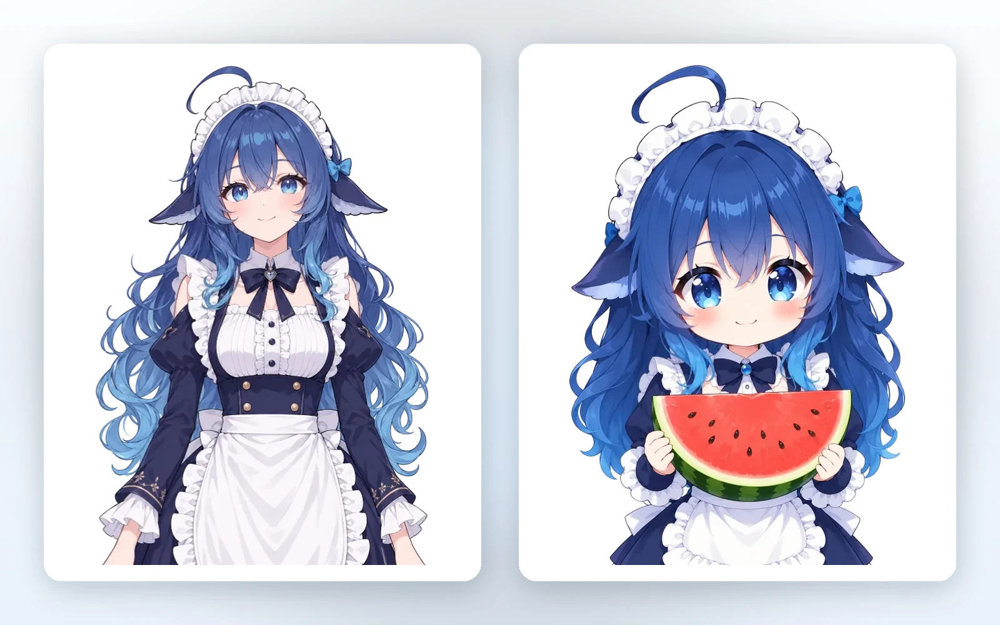

# 安静的鲸鱼娘 · Quiet Whale Girl

[English](README.md) · 简体中文

给 **DeepSeek Harness（DSH）** 用的一只安安静静的 2.5D 鲸鱼娘桌宠。她就待在 DSH Web GUI 的角落，眼睛跟着鼠标走，偶尔眨眨眼、笑一笑，你点她一下她会有小反应。一个小按钮就能在两种形态之间切换：Kujira（仿真人版）和 Kujira Q（Q 版）。

她「安静」是有意为之：**不发声、不联网、不注入提示词、不碰工具、不读会话事件**。只是基于 [LivLiv Player](https://github.com/livliv-dev/player) 在你的 DSH 页面里本地渲染的一个小精灵。

> 这是非官方的社区角色与插件，与 DeepSeek、LivLiv 均无关联，也未获其背书。

## 预览

两种形态都打包在插件里，点桌宠上的小按钮就能切：左边是 Kujira（p01，仿真人版），右边是 Kujira Q（p02，Q 版）。



---

## 功能

- **住在 DSH 里的桌宠** —— 以浮层挂在 DSH Web GUI 之上（`shell.overlay`）。**抓着角色本身就能拖**（整只都能拖，不是只有某个把手），松手后位置记在浏览器 `localStorage` 里。
- **两种鲸鱼形态** —— Kujira（`p01`，仿真人）和 Kujira Q（`p02`，Q 版）。鼠标移到桌宠上会冒出控制条：上面一行换形象，下面一行选表情（`默认 / 笑 / 害羞 / 生气 / 难过`）。
- **温和的生气感** —— 视线跟随鼠标；间隔较长、不规律地眨眼、浅笑或害羞；点一下角色会点头 / 歪头 / 害羞。
- **本地优先** —— 渲染器和角色文件都打包在插件里，由宿主用同源路由提供。无 CDN、无外部 API、无遥测。
- **安静设计** —— 无语音、无 ASR/TTS、无会话或工具事件钩子，不改变你的提示词和 Agent 行为。

## 环境要求

| 项目 | 版本 |
|---|---|
| DeepSeek Harness | web profile，支持插件（`0.1.x` 或 `0.2.x`） |
| Node.js | `>= 22.12.0`（宿主侧，DSH 自带） |
| 浏览器 | WebGL2 + ES2023（Chrome / Edge 97+、Firefox 104+、Safari 15.4+） |

## 安装

从 npm 安装：

```sh
dsh plugin --profile web add dsh-quiet-whale-girl
dsh web
```

从 GitHub 源码安装：

```sh
dsh plugin --profile web add "github:marchinlab/dsh-quiet-whale-girl"
```

或本地链接开发：

```sh
git clone https://github.com/marchinlab/dsh-quiet-whale-girl.git
dsh plugin --profile web add "link:./dsh-quiet-whale-girl"
dsh web
```

打开 `dsh web` 的任意对话，鲸鱼娘就会出现在角落。装完/启用后若没出现，重启一次 `dsh web`。

卸载：

```sh
dsh plugin --profile web remove dsh-quiet-whale-girl
```

## 配置

配置在 bundle patch（`cordis.patch.yml`）里，可在你的 profile 层覆盖：

| 键 | 默认值 | 含义 |
|---|---|---|
| `enabled` | `true` | 桌宠总开关 |
| `character` | `p01` | `p01` = Kujira，`p02` = Kujira Q |
| `size` | `260` | 桌宠宽度（CSS 像素），高度约为宽度的 1.45 倍 |
| `gaze` | `true` | 眼睛 / 头部跟随鼠标 |
| `autoExpressions` | `true` | 偶尔待机眨眼与温和表情 |

页面上的小按钮可切换两只鲸鱼；位置和开关状态都会在本地记住。

## 原理

这是一个标准的 **DSH bundle**：

- `lib/index.js` —— 宿主半区。声明 `inject: ['webServer']`，注册只读的同源路由：
  - `/quiet-whale-girl/config` —— 给浏览器半区的当前配置
  - `/quiet-whale-girl/runtime/*` —— LivLiv Player 的 ES 模块
  - `/quiet-whale-girl/characters/*` —— Kujira / Kujira Q 的模型与贴图
  所有路由只服务 `assets/` 内的文件，`..` 路径穿越会被拒绝。它们注册在裸 `webServer` 上，不自动继承 Connection 的鉴权栅栏，所以每个请求会先过宿主自己的 `ctx.connection.requestRejection`（Host/Origin 校验 + 浏览器登录态）：跨站页面返回 403，未登录返回 401。没有该服务的旧版宿主保持原来的行为。
- `lib/client.js` —— 浏览器半区，手写的 `__ModuleLoader__` 工厂（无构建步骤）。注入 `shell.overlay` 插槽组件，创建 canvas，`import()` 运行时并调用 `new Player(canvas).load(...)`。
- `cordis.patch.yml` —— 把插件行插入 DSH 配置树。

所有注册都放进 `ctx.effect`，卸载插件时路由、监听和定时器会自动清理干净。

## 目录结构

```
dsh-quiet-whale-girl/
├── lib/
│   ├── index.js              宿主半区：HTTP 路由
│   └── client.js             浏览器半区：桌宠浮层
├── assets/
│   ├── runtime/              LivLiv Player 运行时（index.js + chunks）
│   └── characters/
│       ├── p01/              Kujira   （CC BY-NC-SA 4.0）
│       └── p02/              Kujira Q （CC BY-NC-SA 4.0）
├── cordis.patch.yml          DSH bundle patch
├── package.json              bundle 清单
├── icon.webp                 插件图标
├── README.md / README.zh-CN.md
├── CREDITS.md                角色来源与署名
├── LICENSE                   Apache-2.0（插件与渲染器代码）
├── LICENSE-PLAYER            上游 LivLiv Player 许可
├── LICENSE-CHARACTERS        角色许可
└── NOTICE                    第三方声明
```

## 开发

```sh
git clone https://github.com/marchinlab/dsh-quiet-whale-girl.git
cd dsh-quiet-whale-girl
dsh plugin --profile dev add "link:."
dsh --profile dev web
```

没有前端构建步骤 —— 改完 `lib/client.js` 重启 `dsh web` 即可。可用 `node --check lib/index.js && node --check lib/client.js` 校验语法。

## 许可与署名 —— 请务必阅读

本项目包含**两类内容，两套许可**：

| 内容 | 许可 |
|---|---|
| 插件代码（`lib/`、`cordis.patch.yml`、文档）与 `assets/runtime/` 里的 LivLiv Player 渲染器 | **Apache-2.0** —— 见 [LICENSE](LICENSE) 与 [NOTICE](NOTICE) |
| `assets/characters/p01/`、`p02/` 里的鲸鱼娘角色 | **CC BY-NC-SA 4.0**，**仅限非商业** —— 见 [CREDITS.md](CREDITS.md) 与 [LICENSE-CHARACTERS](LICENSE-CHARACTERS) |

**角色署名（任何再使用都必须保留）：**

> Kujira：上善无形、ZipZipPipe（CC BY-NC-SA 4.0）；模型由 LivLiv 制作。

鲸鱼娘角色（鲸鱼娘 / 溟月）原创作者为**上善无形**，女仆设计为 **ZipZipPipe**，分层绑定模型由 **LivLiv** 借助 AI 根据这两张图制作。这两个角色文件夹**不适用** Apache-2.0，也**不适用** LivLiv 精选角色许可，而是 CC BY-NC-SA 4.0：可以署名、非商业地分享与改编，改编须以同一协议分发。

LivLiv Player 引擎 © 2026 LivLiv，Apache-2.0。「Live2D」是 Live2D Inc. 的商标；本项目不使用 Cubism SDK 或任何 Live2D 软件，与 Live2D Inc.、DeepSeek、LivLiv 均无关联。

完整说明与原作者链接见 [CREDITS.md](CREDITS.md) 和 [NOTICE](NOTICE)。

## 免责声明

非官方社区插件，按「现状」提供，不作任何保证。角色为粉丝/社区作品，与 DeepSeek 无关。安装即表示你同意角色素材的非商业条款。若你持有相关角色权利并希望作出调整，请提 issue。
